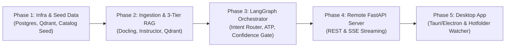

# BetriebsPilot AI — Agent Architecture & Engineering Blueprint

> **Autonomous Back-Office Agent for German Legacy ERPs (SAP Business One, Sage 100, proALPHA, abas)**  
> Target Market: DACH Small & Mid-Sized Suppliers (*Mittelstand Großhandel & Zulieferer*)  
> Compliance: 100% GoBD Auditability & EN 16931 E-Rechnung Standards

---

## 1. Project Vision & Architecture Strategy

### Why a Single Monorepo?
The repository (`betriebspilot-ai`) is maintained as a single monorepo containing both the remote backend agent and the local desktop client:
1. **Shared Schemas & Zero Sync Hell**: The Desktop App (Frontend) and the Remote Agent (Backend) share identical Pydantic / TypeScript data contracts (`ExtractedLineItem`, `ResolvedLineItem`, `ERPOrderPayload`).
2. **Unified Infrastructure**: A single `docker-compose.yml` spins up PostgreSQL 16, Qdrant, and local Ollama with one command.
3. **End-to-End Traceability**: All agent states, RAG cascades, and UI components evolve together in lockstep.

### Why a Desktop App for Legacy ERPs?
German *Mittelstand* suppliers run legacy ERPs (Sage 100, proALPHA, abas, SAP B1) installed on local Windows PCs or internal LAN servers. These legacy systems ingest orders by watching a local file directory (e.g. `C:\ERP_Import\Incoming_Orders\`) for XML/CSV files.
- A standard web browser app cannot write files directly to arbitrary local disk paths due to browser sandbox restrictions.
- The **BetriebsPilot Desktop Client** (Tauri v2 / Electron) runs on the clerk's desktop, communicates with the Remote Agent API (running on GPU/cloud/LAN), and writes validated XML/CSV files directly into the ERP watch-folder upon one-click approval.

---

## 2. Monorepo Directory Layout

```
betriebspilot-ai/
├── README.md                         # Architecture diagram, demo GIF & benchmark metrics
├── docker-compose.yml                # PostgreSQL 16, Qdrant & optional containerized Ollama
├── .env.example                      # Unified configuration template
├── .tool-versions                    # asdf runtime configuration (Python 3.11.11)
├── docs/                             # PRD and Architecture Decision Records (ADRs)
│   ├── BetriebsPilot_AI_ERP_Agent_PRD.pdf
│   └── ADRs/
│       ├── README.md
│       └── 0001-system-architecture-and-technology-stack.md
│
├── agent-backend/                    # 🖥️ REMOTE AI AGENT SERVER (Python 3.11 + FastAPI)
│   ├── Dockerfile
│   ├── pyproject.toml                # Dependencies: Docling, LangGraph, Qdrant, Instructor, Pydantic
│   ├── Modelfile                     # Custom Ollama configuration (Qwen2.5-7B, 8k context, temp=0)
│   ├── data/
│   │   └── seed_german_erp.py        # Seeds Postgres & Qdrant with German SKUs, stock & history
│   ├── src/
│   │   ├── llm/
│   │   │   └── client.py             # Unified Local Ollama / Cloud LLM wrapper + Instructor
│   │   ├── ingestion/
│   │   │   └── parser.py             # Multimodal PDF (Docling), Email & SMS/WhatsApp extractor
│   │   ├── rag/
│   │   │   └── hybrid_retriever.py   # 3-Tier Cascade + Qdrant (BM25 + Dense + Reranker)
│   │   ├── orchestrator/
│   │   │   ├── state.py              # LangGraph AgentState definition
│   │   │   ├── nodes.py              # Intent Router, Order Node, Stock Node, Invoice Node, RMA Node
│   │   │   └── graph.py              # Compiled LangGraph cyclic workflow
│   │   ├── erp_adapters/
│   │   │   ├── opentrans_xml.py      # Generates proALPHA / abas / Sage 100 OpenTRANS 2.1 XML
│   │   │   ├── sap_b1_json.py        # Generates SAP Business One Service Layer payload
│   │   │   └── zugferd_invoice.py    # Generates German E-Rechnung XML/PDF
│   │   └── api/
│   │       └── server.py             # FastAPI REST + SSE Streaming endpoints
│   └── evals/
│       └── benchmark_rag.py          # Golden dataset evaluation script
│
└── desktop-client/                   # 💻 LOCAL DESKTOP APP (Tauri v2 / React + TypeScript)
    ├── package.json
    ├── src-tauri/                    # Native OS integration & Hotfolder file writer
    └── src/
        ├── components/
        │   ├── OmnichannelInput.tsx  # Drag-and-drop PDF, paste Email, or simulate SMS/WhatsApp
        │   ├── AgentLiveTrace.tsx    # Live LangGraph step visualization
        │   ├── SplitScreenReview.tsx # PDF/Text view vs. editable ERP rows with confidence badges
        │   └── ErpExportPanel.tsx    # 1-Click export to local ERP hotfolder
        └── api/
            └── agentClient.ts        # Client SDK for FastAPI REST & SSE endpoints
```

---

## 3. Core Architectural Principles & Invariants

### 3.1 Deterministic Validation & GoBD Compliance
In German commercial law (**GoBD**), financial and tax records must be tamper-proof, auditable, and verifiable:
- **Zero Hallucination Policy**: The LLM is strictly used for unstructured-to-structured parsing (via Instructor + Pydantic).
- **Deterministic Resolvers**: The LLM **never** fabricates internal SKUs, prices, or tax rates. All catalog items, tax calculations (19% standard, 7% reduced, 0% reverse charge), and packaging conversions are resolved deterministically against the ERP database.

### 3.2 3-Tier Cascade SKU Resolution
To resolve vague descriptions (e.g., *"50x O-Ring 22mm from March quote"* or customer part number *"MM-0830-VZ"*):
1. **Tier 1 (Direct Alias Mapping)**: Check `erp_customer_sku_map` for known customer-specific part numbers.
2. **Tier 2 (Historical Context)**: Search customer's past 24 months of order history (`erp_orders` + `erp_order_items`).
3. **Tier 3 (Qdrant Hybrid Search)**: Semantic vector search + BM25 text match over the master catalog (`german_erp_catalog`) in Qdrant.

### 3.3 Deterministic Packaging Math
Orders frequently arrive in customer packaging units (*Kartons, Pakete, Dosen, Rollen*), but legacy ERPs store base units (*Stück, Meter*).
- Conversion: $\text{Base Quantity} = \text{Ordered Quantity} \times \text{Packaging Factor}$ (e.g. $10\text{ Kartons} \times 100 = 1,000\text{ STK}$).

### 3.4 Available-To-Promise (ATP) Inventory Check
Before confirming any order, the agent checks:
$$\text{ATP} = \text{Stock}_{physical} - \text{Stock}_{reserved} + \text{Stock}_{incoming}$$
- If $\text{ATP} \ge \text{Ordered Quantity}$: Item is in stock.
- If $\text{ATP} < \text{Ordered Quantity}$: Item flagged as partial delivery / backorder (*Lieferrückstand*).

### 3.5 Confidence Gate & Human-in-the-Loop (HITL)
- **High Confidence ($\ge 0.95$) & In Stock & Value $< 2,500\text{ EUR}$**: Auto-exportable directly to ERP.
- **Low Confidence ($< 0.95$) or Out-of-Stock or Value $\ge 2,500\text{ EUR}$**: Routed to the Split-Screen UI for clerk verification. Clerk corrections automatically update `erp_customer_sku_map` for self-learning future accuracy.

---

## 4. The 5-Phase Implementation Order



### Phase 1: Infrastructure, Local LLM & German ERP Data Seed (Completed)
- [x] Initialized monorepo with `docker-compose.yml` (Postgres 16 + Qdrant v1.12.1).
- [x] Set up Python 3.11.11 via `asdf` with LZMA and virtual environment.
- [x] Documented architectural decisions in `docs/ADRs/`.
- [x] Executed `seed_german_erp.py` populating 10 German customers, 172 industrial SKUs, stock levels, Tier 1 SKU mappings, 24-month order history, and Qdrant catalog embeddings.

### Phase 2: Ingestion & 3-Tier Cascade RAG (Completed)
- [x] Implement `src/llm/client.py`: Multi-provider LLM client (Ollama / OpenAI / Groq) with Instructor integration.
- [x] Implement `src/ingestion/parser.py`: Multi-channel parser extracting structured line items from German PDF orders, emails, and SMS.
- [x] Implement `src/rag/hybrid_retriever.py`: 3-Tier Cascade SKU resolver + deterministic packaging math.
- [x] Milestone Check: Pass messy German order texts/PDFs and verify exact SKU match + packaging conversion.

### Phase 3: LangGraph Multi-Agent Orchestrator (Completed)
- [x] Define `src/orchestrator/state.py`: `AgentState` TypedDict with line items, confidence scores, ATP stock, and errors.
- [x] Implement `src/orchestrator/nodes.py`:
  - `classify_intent`: Orders, Invoices, RMAs, or Stock checks.
  - `execute_rag_and_stock_check`: 3-Tier cascade + inventory ATP check.
  - `confidence_gate`: Route to auto-export vs. human review.
  - `generate_legacy_file`: Generate OpenTRANS XML / SAP B1 JSON.
- [x] Compile cyclic state machine in `src/orchestrator/graph.py`.

### Phase 4: Remote FastAPI Agent Server (Current)
- [ ] Implement `src/api/server.py`:
  - `POST /api/v1/process-input`: Ingest PDF/Email/SMS, run LangGraph, return state.
  - `POST /api/v1/approve-and-export`: Accept human corrections, update `erp_customer_sku_map`, return XML/JSON.
  - `GET /api/v1/erp-catalog/search`: Manual catalog vector search for clerk overrides.
  - `GET /api/v1/stream-trace/{task_id}`: Real-time SSE streaming of LangGraph node execution.

### Phase 5: Desktop Client (Tauri v2 / React)
- [ ] Build 3-column UI: Input Queue $\rightarrow$ Split-Screen Review $\rightarrow$ Legacy ERP Output Preview.
- [ ] Native hotfolder export: Silent 1-click write to local ERP import folders (`C:\ERP_Import\` or `/tmp/erp_import`).

---

## 5. Coding Standards & Agent Guidelines

1. **Strict Type Safety**: All data structures must use Pydantic v2 `BaseModel` with field descriptions and validation constraints.
2. **Deterministic Boundaries**: Keep LLM reasoning isolated to parsing and intent classification; all pricing, stock math, tax calculations, and database modifications must run in deterministic Python functions.
3. **No Unhandled Exceptions**: All external API calls, database queries, and vector operations must be wrapped in structured try-except blocks with clean fallback states.
4. **Self-Documenting Code**: Preserve existing comments and docstrings. Add concise docstrings to all new modules and public functions.
