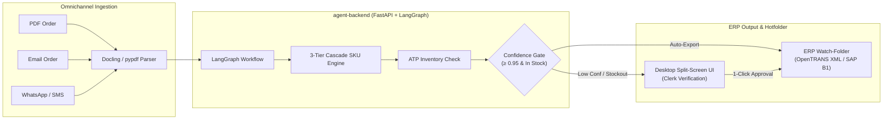

# BetriebsPilot AI

> **Autonomous Commercial Back-Office Agent for German Legacy ERPs**  
> *Target Market*: DACH Small & Mid-Sized Suppliers (*Mittelstand Großhandel & Zulieferer*)  
> *Legacy ERP Compatibility*: SAP Business One, Sage 100, proALPHA, abas  
> *Compliance*: 100% GoBD Auditability & EN 16931 E-Rechnung Standards

---

## 🚀 Key Features

* **Zero Hallucination Policy (100% GoBD Compliant)**: The LLM is strictly restricted to parsing unstructured German purchase orders (PDF, Email, WhatsApp). All article SKUs, pricing, packaging factors, and tax rates (19% standard, 7% reduced) are deterministically resolved against the ERP database.
* **3-Tier Cascade SKU Resolution**:
  * **Tier 1 (Direct Alias Mapping)**: Customer-specific part numbers (`erp_customer_sku_map`).
  * **Tier 2 (Historical Context)**: 24-month order history lookup (`erp_orders` + `erp_order_items`).
  * **Tier 3 (Qdrant Hybrid Search)**: Vector similarity + BM25 text match over the master industrial catalog.
* **Deterministic Packaging Math**: Automatically converts customer packaging units (*10 Kartons à 100 Stück = 1,000 STK*) into ERP base units.
* **Available-to-Promise (ATP) Inventory Check**: $\text{ATP} = \text{Stock}_{\text{physical}} - \text{Stock}_{\text{reserved}} + \text{Stock}_{\text{incoming}}$.
* **Legacy ERP Hotfolder Bridge**: Generates compliant **OpenTRANS 2.1 XML** and **SAP Business One JSON** payloads for direct local file writing into ERP watch-folders.

---

## 🏗️ Architecture



---

## ⚡ Quickstart: Playing & Testing the Backend

### 1. Start Infrastructure (PostgreSQL & Qdrant)
```bash
docker compose up -d
```

### 2. Activate Python Virtual Environment
```bash
# In Bash/Zsh:
source agent-backend/.venv/bin/activate

# In Fish:
source agent-backend/.venv/bin/activate.fish
```

### 3. Run the Development Server
```bash
PYTHONPATH=agent-backend uvicorn src.api.server:app --reload --port 8000
```
- **Interactive Swagger UI**: [http://localhost:8000/docs](http://localhost:8000/docs)
- **ReDoc Documentation**: [http://localhost:8000/redoc](http://localhost:8000/redoc)
- **Health Check**: [http://localhost:8000/health](http://localhost:8000/health)

### 4. Run the Interactive CLI Demo
See the entire 3-Tier SKU resolution and packaging math pipeline in action:
```bash
PYTHONPATH=agent-backend python agent-backend/evals/demo_end_to_end_resolution.py
```

### 5. Run the Test Suite (41 Automated Tests)
```bash
PYTHONPATH=agent-backend pytest agent-backend/tests/ -v
```

---

## 📚 Documentation & Engineering Wiki

Complete documentation and architecture deep-dives are located in [`docs/wiki/`](docs/wiki/):

* **[🚀 Hands-On Guide: Playing, Testing & Debugging the Backend](docs/wiki/getting-started/hands-on-backend-guide.md)**
* **[FastAPI Server Architecture & SSE Streaming](docs/wiki/api/fastapi-server-architecture.md)**
* **[3-Tier Cascade SKU Resolution & Packaging Math](docs/wiki/rag/three-tier-cascade.md)**
* **[LangGraph Multi-Agent Orchestrator](docs/wiki/orchestrator/langgraph-workflow.md)**
* **[Ingestion Parser Deep-Dive](docs/wiki/ingestion/ingestion-parser-deep-dive.md)**
* **[How Vector Search Works Under the Hood](docs/wiki/vector-database/how-it-works.md)**
* **[ADRs (Architecture Decision Records)](docs/ADRs/)**
