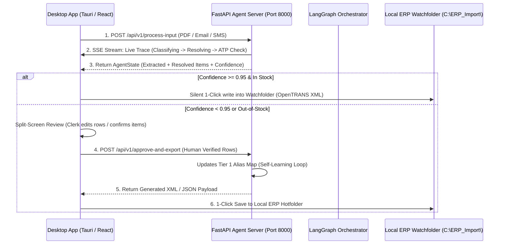

# FastAPI Agent Server & Real-Time SSE Streaming Architecture

> **BetriebsPilot AI Wiki** • API & Integration Architecture • Python Engineering Deep-Dive  
> **Topic**: REST Endpoints, Multipart PDF Uploads, Server-Sent Events (SSE), and Desktop Client SDK Contracts

---

## 1. Architectural Role in BetriebsPilot AI

The **FastAPI Agent Server (`src/api/server.py`)** serves as the remote AI engine that powers the **Desktop Client (Tauri v2 / React)**. 

Because German legacy ERPs (SAP Business One, Sage 100, proALPHA) run inside local customer Windows/LAN environments, the Desktop App acts as the local bridge, while this FastAPI backend runs on the supplier's server or GPU instance:



---

## 2. Core Python Patterns Used in the API Server

### 2.1 Multipart File & Text Ingestion (`UploadFile`)

In standard web development, endpoints accept either JSON bodies *or* raw file uploads. In BetriebsPilot AI, the clerk can drag-and-drop a PDF file **or** paste raw email text into the exact same unified interface:

```python
from fastapi import FastAPI, UploadFile, File, Form
from typing import Optional

@app.post("/api/v1/process-input")
async def process_input_endpoint(
    file: Optional[UploadFile] = File(None),
    raw_text: Optional[str] = Form(None),
    channel: str = Form("email"),
    customer_id: str = Form("DE-10021"),
    export_format: str = Form("opentrans_xml")
):
    if file:
        content_bytes = await file.read()
        # Process PDF bytes stream
    elif raw_text:
        # Process email/chat string
```

#### Why `UploadFile` over `bytes`?
* `UploadFile` utilizes Python's `tempfile.SpooledTemporaryFile`. Small files remain in memory; large files exceeding 1MB are automatically buffered to disk, preventing Denial-of-Service memory exhaustion when handling 100-page supplier catalogs.

---

### 2.2 Server-Sent Events (SSE) Streaming (`EventSourceResponse`)

Modern AI interfaces must not appear frozen while a multi-agent graph runs. Rather than polling every second, FastAPI uses **Server-Sent Events (SSE)** to stream real-time execution steps directly to the Desktop App:

```python
import asyncio
from sse_starlette.sse import EventSourceResponse

@app.get("/api/v1/stream-trace/{task_id}")
async def stream_task_trace(task_id: str):
    async def event_generator():
        for step in ["classify_intent", "ingest_and_resolve", "check_inventory_atp", "confidence_gate"]:
            yield {
                "event": "node_execution",
                "data": json.dumps({"task_id": task_id, "node": step, "status": "running"})
            }
            await asyncio.sleep(0.3)
    return EventSourceResponse(event_generator())
```

---

### 2.3 Cross-Origin Resource Sharing (CORS) for Desktop Tauri Apps

When building a desktop app with Tauri or Electron, the local frontend runs on internal custom origins (e.g., `http://localhost:1420` in Vite development mode, or `tauri://localhost` in production Windows/macOS builds).

We configure FastAPI's `CORSMiddleware` to authorize these origins explicitly:

```python
from fastapi.middleware.cors import CORSMiddleware

app.add_middleware(
    CORSMiddleware,
    allow_origins=[
        "http://localhost:1420",  # Tauri / Vite dev server
        "http://localhost:3000",  # Next.js / Web dev server
        "tauri://localhost",      # Tauri v2 production
        "http://tauri.localhost"
    ],
    allow_credentials=True,
    allow_methods=["*"],
    allow_headers=["*"],
)
```

---

## 3. API Endpoints Specification

### 1. `POST /api/v1/process-input`
* **Request**: Multipart form data with optional `file`, optional `raw_text`, `channel`, `customer_id`, and `export_format`.
* **Action**: Invokes the LangGraph orchestrator (`run_agent_pipeline`).
* **Response**: Full `AgentState` JSON (detected intent, extracted items, resolved catalog SKUs, ATP stock availability, confidence scores, and review flags).

### 2. `POST /api/v1/approve-and-export`
* **Request**: JSON body with `task_id`, `customer_id`, list of approved `line_items`, and `export_format`.
* **Action**:
  1. Calls `learn_customer_alias()` to insert new clerk overrides into `erp_customer_sku_map` (Tier 1 self-learning).
  2. Generates the final **OpenTRANS 2.1 XML** or **SAP Business One JSON**.
* **Response**: Raw file content string ready to be saved into the local watchfolder by the desktop client.

### 3. `GET /api/v1/erp-catalog/search`
* **Request**: Query parameters: `query: str`, `limit: int = 5`, `category: Optional[str]`.
* **Action**: Vector search over Qdrant collection `german_erp_catalog`.
* **Response**: List of candidate articles for manual clerk override in the UI.

### 4. `GET /api/v1/stream-trace/{task_id}`
* **Action**: SSE stream broadcasting real-time LangGraph step notifications.

### 5. `GET /health`
* **Action**: Comprehensive health check verifying PostgreSQL connection, Qdrant vector store status, and active LLM provider.
