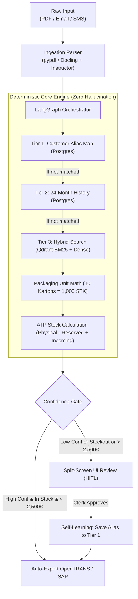

# Hands-On Guide: Playing, Testing & Debugging the Agent Backend

> **Audience**: Developers, AI engineers, and curious team members who want to understand, test, debug, and interact with the `agent-backend` without needing to be Python veterans.

---

## 1. The Big Picture: Mental Model of `agent-backend`

German *Mittelstand* suppliers receive messy, unstructured purchase orders every day via **PDF email attachments, email text, and WhatsApp messages**:
> *"Hallo Herr Müller, bitte liefern Sie uns 10 Kartons DIN 933 Schrauben M8x30 wie im März-Angebot und 50 O-Ringe MM-0830-VZ per Express bis nächsten Freitag."*

Legacy ERP systems (SAP Business One, Sage 100, proALPHA, abas) cannot understand natural language. They require **strict, validated XML or JSON** with:
- Exact internal article numbers (e.g., `ART-DIN-M8X30-88-1010`)
- Exact base units (e.g., converting 10 Kartons à 100 Stück = 1,000 Stück)
- Accurate Available-to-Promise (ATP) stock availability
- Exact net/gross pricing with 19% German VAT (GoBD compliant, zero hallucination)

The **`agent-backend`** is the autonomous engine that takes that unstructured text or PDF and turns it into validated ERP payloads.



---

## 2. Codebase Anatomy & Map

Here is what every folder and file in `agent-backend/src/` does:

```
agent-backend/
├── data/
│   └── seed_german_erp.py        # Populates 10 German customers, 172 articles, stock, & Qdrant vectors
├── src/
│   ├── llm/
│   │   └── client.py             # Multi-provider LLM factory (Ollama, OpenAI, Groq) with Instructor
│   ├── ingestion/
│   │   ├── schemas.py            # Pydantic models (RawExtractedDocument, ExtractedLineItem)
│   │   ├── preprocessors.py      # Regex cleansers for email headers, signatures, and WhatsApp timestamps
│   │   └── parser.py             # Parses PDF/Email into structured line items using the LLM
│   ├── rag/
│   │   ├── schemas.py            # Data models for resolution (ResolvedLineItem, ATPStock)
│   │   └── hybrid_retriever.py   # 3-Tier Cascade SKU Resolver & Packaging Math (No LLM needed!)
│   ├── erp_adapters/
│   │   ├── opentrans_xml.py      # Generates OpenTRANS 2.1 XML for Sage 100 / proALPHA / abas
│   │   └── sap_b1_json.py        # Generates SAP Business One Service Layer JSON
│   ├── orchestrator/
│   │   ├── state.py              # LangGraph AgentState (Blackboard data structure)
│   │   ├── nodes.py              # Orchestrator steps (classify_intent, stock_check, confidence_gate)
│   │   └── graph.py              # State graph connecting nodes into an executable pipeline
│   └── api/
│       ├── schemas.py            # REST API input/output models with Swagger examples
│       └── server.py             # FastAPI server, REST routes, CORS, and SSE streaming
└── tests/                        # 41 automated tests verifying every single module
```

### Which Parts Use an LLM vs. Pure Deterministic Python?

| Module | Uses LLM? | Why? |
| :--- | :--- | :--- |
| **`ingestion/parser.py`** | **YES** | Extracting items from natural German language or messy PDF tables. |
| **`orchestrator/nodes.py` (intent)** | **YES** | Classifying if a message is an Order, RMA, Stock Inquiry, or Invoice. |
| **`rag/hybrid_retriever.py`** | **NO (100% Deterministic)** | Database queries + FastEmbed ONNX vectors. Financial data cannot hallucinate. |
| **Stock & ATP Math** | **NO (100% Deterministic)** | $\text{Stock}_{\text{phys}} - \text{Stock}_{\text{res}} + \text{Stock}_{\text{inc}}$. |
| **Packaging Math** | **NO (100% Deterministic)** | $\text{Ordered Qty} \times \text{Packaging Factor} = \text{Base Qty}$. |
| **`erp_adapters/*.py`** | **NO (100% Deterministic)** | Strict XML / JSON schema compliance for ERP watch folders. |
| **`api/server.py`** | **NO (Only routes)** | Dispatches requests to the above services. |

---

## 3. Getting Started: Running the Environment

### Step 3.1: Verify Docker Containers (PostgreSQL & Qdrant)
The backend requires PostgreSQL (port `5432`) and Qdrant (ports `6333`, `6334`):

```bash
# Check running containers
docker ps
```

If not running, start them from the project root:
```bash
docker compose up -d
```

### Step 3.2: Activate the Python Virtual Environment
The virtual environment is located at `agent-backend/.venv`.

**If you use Fish shell:**
```fish
source agent-backend/.venv/bin/activate.fish
```

**If you use Zsh or Bash:**
```bash
source agent-backend/.venv/bin/activate
```

Verify your Python interpreter:
```bash
which python
# Should output: .../betriebspilot-ai/agent-backend/.venv/bin/python
```

### Step 3.3: Start the FastAPI Server
Run Uvicorn with auto-reload:

```bash
PYTHONPATH=agent-backend uvicorn src.api.server:app --reload --port 8000
```

You will see output like this:
```
INFO:     Started server process
INFO:     Waiting for application startup.
INFO:     Uvicorn running on http://127.0.0.1:8000 (Press CTRL+C to quit)
```

---

## 4. Interactive Swagger UI Playground (`http://localhost:8000/docs`)

Open your browser to:
👉 **[http://localhost:8000/docs](http://localhost:8000/docs)**

You will see the interactive OpenAPI Swagger UI. Here are 4 concrete scenarios you can test right now:

### Scenario 1: Health & Diagnostics (`GET /health`)
1. Click **`GET /health`** $\rightarrow$ Click **"Try it out"** $\rightarrow$ Click **"Execute"**.
2. **What to observe**:
   - `database.connected`: `true` (PostgreSQL 16)
   - `qdrant.connected`: `true` (`german_erp_catalog` collection with 172 vectors)

---

### Scenario 2: Semantic Catalog Search (`GET /api/v1/erp-catalog/search`)
Test Qdrant's vector search over industrial fastener and sealing items without any LLM!

1. Click **`GET /api/v1/erp-catalog/search`** $\rightarrow$ Click **"Try it out"**.
2. Set `query`: `Sechskantschraube M8 Edelstahl` (Hex bolt M8 stainless steel).
3. Set `limit`: `3`.
4. Click **"Execute"**.
5. **Expected Response**:
   ```json
   [
     {
       "sku": "ART-DIN-M8X20-A2-1009",
       "title_de": "DIN 933 Sechskantschraube M8x20 (A2 Edelstahl)",
       "category": "Verbindungstechnik",
       "packaging_unit": "Karton",
       "packaging_qty": 100,
       "unit_price_net": 0.28,
       "score": 0.842
     }
   ]
   ```

---

### Scenario 3: 1-Click Human Approval & ERP File Export (`POST /api/v1/approve-and-export`)
Simulate a clerk approving an order in the desktop Split-Screen UI:

1. Click **`POST /api/v1/approve-and-export`** $\rightarrow$ Click **"Try it out"**.
2. Paste this JSON payload:
   ```json
   {
     "task_id": "demo-task-001",
     "customer_id": "DE-10021",
     "customer_order_number": "BESTELLUNG-2026-X99",
     "order_date": "2026-11-07",
     "delivery_date": "2026-11-14",
     "export_format": "opentrans_xml",
     "learn_aliases": true,
     "approved_line_items": [
       {
         "line_number": 1,
         "raw_item_number": "KUNDE-SCHRAUBE-8X30",
         "matched_sku": "ART-DIN-M8X30-88-1010",
         "title_de": "DIN 933 Sechskantschraube M8x30 (8.8 verzinkt)",
         "base_quantity": 500,
         "base_uom": "STK",
         "unit_price_net": 0.18,
         "total_price_net": 90.0,
         "tax_rate": 19.0
       }
     ]
   }
   ```
3. Click **"Execute"**.
4. **What happened behind the scenes?**
   - The backend generated a compliant **OpenTRANS 2.1 XML** file ready to be saved into the ERP watchfolder.
   - Because `learn_aliases` was `true`, it automatically inserted `("DE-10021", "KUNDE-SCHRAUBE-8X30" -> "ART-DIN-M8X30-88-1010")` into PostgreSQL table `erp_customer_sku_map`.
   - Next time customer `DE-10021` orders `"KUNDE-SCHRAUBE-8X30"`, Tier 1 will resolve it instantly with 1.0 confidence!

---

### Scenario 4: Real-Time SSE Stream Trace (`GET /api/v1/stream-trace/{task_id}`)
See real-time LangGraph execution events stream:

1. In your browser or terminal, run:
   ```bash
   curl -N http://localhost:8000/api/v1/stream-trace/test-task-123
   ```
2. You will see Server-Sent Events stream in real time:
   ```
   event: trace
   data: {"node": "classify_intent", "status": "COMPLETED"}

   event: trace
   data: {"node": "execute_rag_and_stock_check", "status": "COMPLETED"}

   event: trace
   data: {"node": "confidence_gate", "status": "COMPLETED"}
   ```

---

## 5. Testing Like a Pro: Pytest Mastery

We use `pytest` for all backend testing. Here are the most useful commands:

### Run Everything (All 41 Tests)
```bash
PYTHONPATH=agent-backend pytest agent-backend/tests/ -v
```

### Run Only API Server Tests
```bash
PYTHONPATH=agent-backend pytest agent-backend/tests/test_api_server.py -v
```

### Run Only RAG Cascade & Math Tests
```bash
PYTHONPATH=agent-backend pytest agent-backend/tests/test_hybrid_retriever.py -v
```

### Run One Specific Test by Name (`-k`)
```bash
PYTHONPATH=agent-backend pytest agent-backend/tests/ -k "test_packaging_math_direct" -v
```

### See Print Statements / Logs While Running Tests (`-s`)
Pytest suppresses stdout by default. Use `-s` to see `print()` output:
```bash
PYTHONPATH=agent-backend pytest agent-backend/tests/test_hybrid_retriever.py -k "test_resolve_document_end_to_end" -s
```

### Show Detailed Tracebacks on Failure (`--tb=long` or `--tb=short`)
```bash
PYTHONPATH=agent-backend pytest agent-backend/tests/ --tb=short
```

---

## 6. Debugging Secrets & Code Inspection

### 6.1 Drop into an Interactive Debugger with `breakpoint()`
If a test or endpoint behaves unexpectedly, you can pause execution and inspect variables in the terminal.

1. Add `breakpoint()` anywhere in your Python code:
   ```python
   def calculate_packaging_math(...):
       breakpoint()  # Execution will freeze here!
       ...
   ```
2. Run pytest with `-s`:
   ```bash
   PYTHONPATH=agent-backend pytest agent-backend/tests/test_hybrid_retriever.py -s
   ```
3. The terminal will pause at `(Pdb)`:
   - Type `p variable_name` to inspect the value.
   - Type `c` to continue.
   - Type `q` to quit.

---

### 6.2 Inspect PostgreSQL Directly
Want to verify what is actually stored in the database?

```bash
# Connect using psql via docker
docker exec -it betriebspilot-postgres psql -U betriebspilot -d betriebspilot_erp
```

Useful SQL queries:
```sql
-- See customer list
SELECT customer_id, company_name, city FROM erp_customers;

-- See seeded stock inventory for an article
SELECT a.sku, a.title_de, s.physical_stock, s.reserved_stock, s.incoming_stock
FROM erp_articles a
JOIN erp_stock s ON a.sku = s.sku
WHERE a.sku = 'ART-DIN-M8X30-88-1010';

-- See learned customer part aliases
SELECT customer_id, raw_customer_sku, matched_internal_sku, confidence_score
FROM erp_customer_sku_map;
```

---

### 6.3 Inspect Qdrant Vector Points Directly
Qdrant provides a built-in REST API and Web Dashboard at `http://localhost:6333/dashboard`:

```bash
# Query collection info via curl
curl -s http://localhost:6333/collections/german_erp_catalog | jq .
```
Or open **`http://localhost:6333/dashboard`** in your browser to visually explore the 172 catalog embeddings!

---

## 7. Interactive CLI Playground Script

Want to see the entire backend pipeline run interactively in 1 second?
Run the built-in demo script:

```bash
PYTHONPATH=agent-backend python agent-backend/evals/demo_end_to_end_resolution.py
```

This script:
1. Simulates messy German customer line items (e.g. `MM-0830-VZ`, vague description `10 Kartons DIN 933 M8x30 verzinkt`).
2. Runs the 3-Tier Cascade resolver (Tier 1 $\rightarrow$ Tier 2 $\rightarrow$ Tier 3).
3. Applies packaging math ($10 \text{ Kartons} \times 100 = 1,000 \text{ STK}$).
4. Computes Available-to-Promise (ATP) stock.
5. Prints the complete GoBD-compliant breakdown in your terminal!
