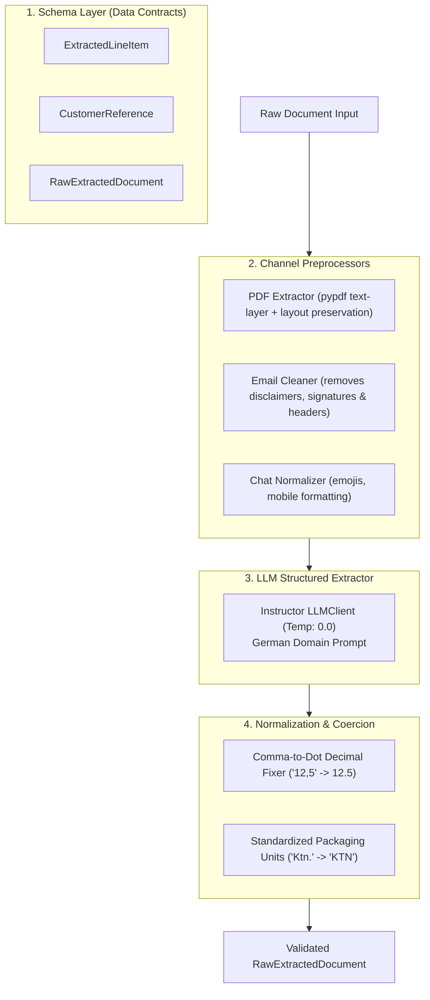

# Ingestion Parser: Python Engineering & Architectural Deep-Dive

> **BetriebsPilot AI Wiki** • Python for AI Engineers • Architecture Deep-Dive  
> **Topic**: Data Extraction Pipeline, Pydantic v2, Instructor, Type Hinting, and Multi-Channel Ingestion

---

## 1. Executive Overview

Small German B2B suppliers receive purchase orders in chaotic formats:
- **PDFs**: Scanned or digitally generated purchase orders with varying column structures.
- **Emails**: Free-text emails with informal requests (*"Schickt uns 10 Kartons Schrauben wie besprochen"*).
- **Chat**: WhatsApp and SMS field messages from construction sites and technicians.

The **Ingestion Parser (`src/ingestion/parser.py`)** is the first processing stage in BetriebsPilot AI. Its sole architectural responsibility is:

$$\text{Unstructured Input (PDF / Email / SMS)} \longrightarrow \text{Strict Structured Contract (\texttt{RawExtractedDocument})}$$

To build this reliably in Python without bugs, we use modern Python 3.11 patterns: **Pydantic v2 schemas**, **Instructor structured prompting**, **Type Hints & Generics**, and **defensive stream handling**.

---

## 2. Python Concepts Used in Modern AI Agents

If you are coming to Python from other languages (like TypeScript, Java, or C#) or are learning Python for AI engineering, here is a breakdown of the specific language features we use and *why* they matter.

---

### 2.1 Type Hinting & Static Typing

Python is dynamically typed by default, but enterprise AI applications require strict type safety to prevent runtime crashes.

```python
from typing import Optional, List, Dict, Union, Literal
from pathlib import Path

def parse_order(
    content: Union[str, bytes, Path],  # Can be a text string, raw bytes, or a file path
    channel: Literal["pdf", "email", "whatsapp", "sms"],  # Must be one of these exact strings
    max_items: Optional[int] = None    # Can be an integer or None
) -> List[Dict[str, float]]:           # Returns a list of dictionaries with string keys and float values
    ...
```

#### Key Types Explained:
* `Union[A, B]`: The parameter can be type `A` **or** type `B`.
* `Optional[T]`: Shorthand for `Union[T, None]`. Indicates the value can be missing (`None`).
* `Literal["pdf", "email"]`: Restricts values to only those exact strings (like TypeScript string literal union types).
* `TypeVar("T")`: A generic placeholder used for functions that accept or return any Pydantic model.

---

### 2.2 Pydantic v2: Data Contracts & Runtime Validation

In normal Python, a dictionary is loose and unverified:
```python
# Unsafe Python dictionary:
order = {"qty": "ten", "price": -5.0}  # No error, but corrupts your database!
```

**Pydantic v2** enforces strict data contracts at runtime:

```python
from pydantic import BaseModel, Field, field_validator

class ExtractedLineItem(BaseModel):
    line_number: int = Field(description="Line position 1, 2, 3...")
    raw_description: str = Field(min_length=2, description="Product description")
    quantity: float = Field(gt=0, description="Quantity must be greater than zero")
    raw_uom: str = Field(default="STK", description="Unit of measure (e.g., STK, Karton)")
    unit_price_quoted: Optional[float] = Field(default=None, ge=0.0)

    # Custom validator: Converts German decimal commas ("12,50") to standard floats (12.50)
    @field_validator("quantity", mode="before")
    @classmethod
    def clean_german_number(cls, value: Union[str, float, int]) -> float:
        if isinstance(value, str):
            clean_str = value.replace(".", "").replace(",", ".")
            return float(clean_str)
        return float(value)
```

#### Why Pydantic is Mandatory for AI Agents:
1. **Schema Generation**: Pydantic models automatically export JSON schemas that tell the LLM exactly what structure to output.
2. **Coercion**: If the LLM returns `"quantity": "5"`, Pydantic automatically converts it into the integer or float `5.0`.
3. **Data Protection**: If the LLM produces negative quantities or skips mandatory fields, Pydantic raises a validation error immediately before any database write occurs.

---

### 2.3 The Instructor Pattern: Structured LLMs

Raw LLMs output plain text strings. Even when asked for JSON, standard LLMs often return markdown code fences (````json ... ````), invalid formatting, or hallucinated fields.

**Instructor** wraps Python LLM clients (like `OpenAI` or `Ollama`) to enforce schema compliance:

```
[Prompt + Text Input]
        │
        ▼
[LLM Generates JSON]
        │
        ▼
[Instructor Validates against Pydantic Model]
        ├─── Valid? ──► Returns Python Object directly!
        │
        └─── Invalid? ──► Auto-Retries: Sends validation error back to LLM to fix itself!
```

#### Python Code Example:
```python
import instructor
from openai import OpenAI
from pydantic import BaseModel

class CustomerOrder(BaseModel):
    customer_name: str
    item_count: int

# Wrap standard client with Instructor
client = instructor.from_openai(OpenAI())

# The LLM output is guaranteed to be an instance of CustomerOrder
order = client.chat.completions.create(
    model="gpt-4o-mini",
    response_model=CustomerOrder,  # <-- Tell Instructor what schema to enforce
    messages=[{"role": "user", "content": "Hans Müller hier, ich brauche 5 Schrauben"}]
)

print(order.customer_name)  # "Hans Müller"
print(order.item_count)     # 5
```

---

### 2.4 File & Stream Handling (`Path`, `bytes`, `BytesIO`)

In legacy German ERP environments, files come from diverse sources: uploaded via REST API, read from disk hotfolders, or received via email attachments.

```python
import io
from pathlib import Path
from typing import Union

def extract_pdf_text(source: Union[str, Path, bytes, io.BytesIO]) -> str:
    # 1. If it's a file path string or Path object
    if isinstance(source, (str, Path)):
        path = Path(source)
        if not path.exists():
            raise FileNotFoundError(f"PDF file does not exist: {path}")
        with open(path, "rb") as f:
            pdf_bytes = f.read()
    
    # 2. If it's already bytes in memory
    elif isinstance(source, bytes):
        pdf_bytes = source
        
    # 3. If it's a file stream (BytesIO)
    elif isinstance(source, io.BytesIO):
        pdf_bytes = source.getvalue()
        
    else:
        raise ValueError(f"Unsupported source type: {type(source)}")

    # Process bytes safely...
    return f"Extracted {len(pdf_bytes)} bytes."
```

#### Why `pathlib.Path` over `os.path`:
`pathlib.Path` is Python's modern object-oriented filesystem library. It automatically handles differences between Windows (`C:\ERP_Import\`) and Linux/Mac paths (`/tmp/erp_import/`).

---

### 2.5 Regex & Preprocessing for German Business Documents

Before sending messy emails or PDFs to the LLM, sanitizing the text reduces token costs by 40–60% and prevents the model from being confused by legal disclaimers.

```python
import re

def clean_german_email(raw_text: str) -> str:
    # 1. Remove German legal disclaimers
    disclaimer_pattern = r"(?i)(Diese E-Mail enthält vertrauliche|Hinweis zum Datenschutz|Rechtlicher Hinweis:).*"
    cleaned = re.sub(disclaimer_pattern, "", raw_text, flags=re.DOTALL)
    
    # 2. Remove forwarded email headers (Von: ... Gesendet: ...)
    reply_header_pattern = r"(?m)^(Von|Gesendet|An|Betreff):\s+.*$"
    cleaned = re.sub(reply_header_pattern, "", cleaned)
    
    # 3. Collapse multiple blank lines into single newlines
    cleaned = re.sub(r"\n{3,}", "\n\n", cleaned)
    
    return cleaned.strip()
```

---

## 3. Architecture of `src/ingestion/parser.py`

The ingestion parser is organized into four modular layers:



---

## 4. Why We Use a Hybrid PDF Strategy (`pypdf` + `Docling`)

| Feature | `pypdf` (Fast Digital Extractor) | `Docling` (Advanced Layout Parser) |
|:---|:---|:---|
| **Speed** | **15 – 45 milliseconds** | 1.5 – 6.0 seconds |
| **Dependencies** | Pure Python, lightweight | Heavy PyTorch / Hugging Face models |
| **Best Used For** | 95% of German ERP purchase orders (vector PDFs generated from SAP B1, Sage 100, Navision). | Scanned photocopies, faxed orders, multi-column brochures. |
| **Architectural Design** | **Primary Default** in BetriebsPilot AI. | **Pluggable Adapter** toggled via configuration when OCR is required. |

---

## 5. Summary & Checklist Before Implementation

1. **Strict GoBD Isolation**: `parser.py` never matches internal database SKUs or calculates prices.
2. **Pydantic Validation**: All line items must have `quantity > 0` and standard UoM codes.
3. **Multi-Channel Interface**: One single function handles PDFs, Emails, WhatsApp, and SMS seamlessly:
   ```python
   doc = parser.parse(content=raw_input, channel=InputChannel.EMAIL)
   ```
