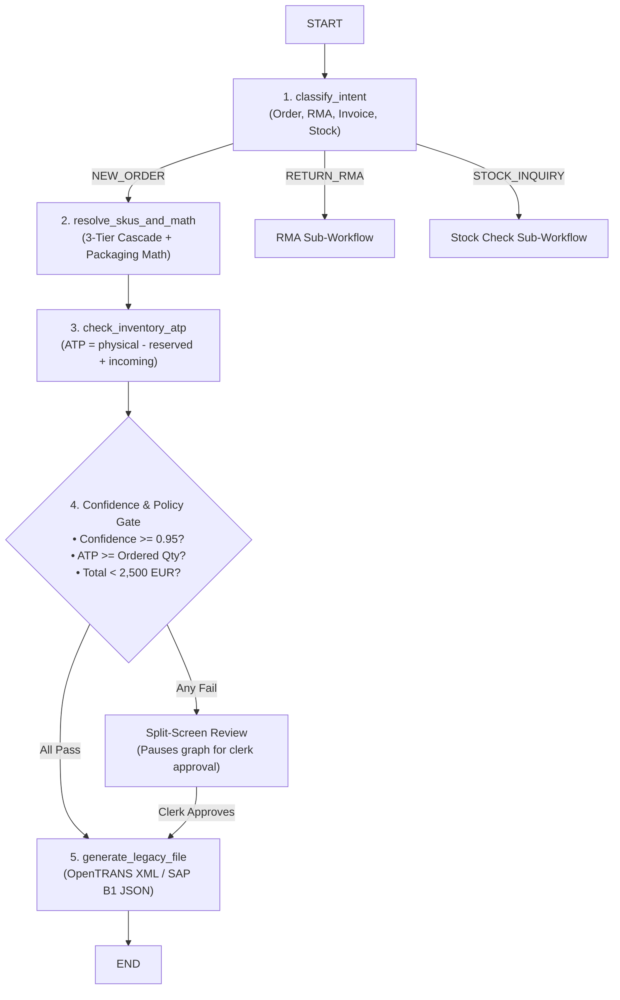

# LangGraph State Machine & Multi-Agent Orchestration

> **BetriebsPilot AI Wiki** • Orchestrator Architecture • Python Engineering Deep-Dive  
> **Topic**: Stateful Cyclic Graphs, `TypedDict` State, Available-to-Promise (ATP) Inventory Checks, and Confidence Gates

---

## 1. Why LangGraph for German ERP Automation?

Naive AI prototypes use simple "chains" (e.g. `Prompt -> LLM -> Output`). In enterprise German B2B environments, linear chains fail for three critical reasons:

1. **Statefulness**: An order lifecycle spans multiple asynchronous steps: Document Ingestion $\rightarrow$ SKU Resolution $\rightarrow$ Real-time Inventory Verification $\rightarrow$ Human Sign-off $\rightarrow$ XML/JSON ERP Export.
2. **Cyclic Correction Loops**: If an item is out of stock, the agent must not blindly book it into the ERP. It must branch into substitute lookups, calculate backorders (*Lieferrückstand*), or pause for clerk guidance.
3. **GoBD Compliance & Auditability**: German tax and commercial laws require a deterministic audit trail of every state mutation. LangGraph preserves the complete state snapshot at every node transition.

---

## 2. Python Concepts Behind LangGraph

### 2.1 `TypedDict` as the Shared "Blackboard" State

In LangGraph, data is not passed from function to function via nested return arguments. Instead, all agent nodes share a central blackboard state defined using Python's `typing.TypedDict`:

```python
from typing import TypedDict, List, Optional, Dict, Any
from enum import Enum

class IntentType(str, Enum):
    NEW_ORDER = "NEW_ORDER"
    RETURN_RMA = "RETURN_RMA"
    STOCK_INQUIRY = "STOCK_INQUIRY"
    INVOICE_QUERY = "INVOICE_QUERY"

class AgentWorkflowStatus(str, Enum):
    INITIALIZED = "INITIALIZED"
    RESOLVED = "RESOLVED"
    READY_FOR_EXPORT = "READY_FOR_EXPORT"
    NEEDS_HUMAN_REVIEW = "NEEDS_HUMAN_REVIEW"
    EXPORTED = "EXPORTED"

class AgentState(TypedDict):
    """The central state dictionary passed to every LangGraph node."""
    raw_content: str
    channel: str
    customer_id: str
    intent: Optional[IntentType]
    status: AgentWorkflowStatus
    extracted_document: Optional[Dict[str, Any]]
    resolved_items: List[Dict[str, Any]]
    inventory_checks: List[Dict[str, Any]]
    overall_confidence: float
    total_net_amount: float
    requires_human_review: bool
    review_reasons: List[str]
    generated_export_payload: Optional[str]
    export_format: str  # 'opentrans_xml' or 'sap_b1_json'
    execution_trace: List[str]
```

#### Why `TypedDict` over Standard `dict`?
* **IDE Auto-completion**: Every key in the state is strictly typed.
* **Static Analysis**: `mypy` or Python language servers immediately flag typos (e.g. `state["resolvd_items"]`).
* **Immutability & Merging**: LangGraph automatically manages state merges when nodes return partial updates (e.g. returning `{"status": "RESOLVED"}` only updates the status key without erasing the rest).

---

### 2.2 Nodes: Pure Python Transformer Functions

Every node in the graph is a standard Python function that takes `state: AgentState` and returns a dictionary containing only the keys that were modified:

```python
def classify_intent_node(state: AgentState) -> Dict[str, Any]:
    text = state["raw_content"]
    # LLM or deterministic rule classifies intent
    detected_intent = IntentType.NEW_ORDER
    return {
        "intent": detected_intent,
        "execution_trace": state["execution_trace"] + ["classify_intent"]
    }
```

---

### 2.3 Conditional Edges: Dynamic Routing

Unlike static scripts, LangGraph uses **conditional edges** to inspect the state and determine the next node dynamically:

```python
def confidence_routing_edge(state: AgentState) -> str:
    """Decides whether to auto-export or route to Split-Screen Human Review."""
    if state["requires_human_review"]:
        return "human_review_node"
    return "generate_legacy_file_node"
```

---

## 3. The 5-Node BetriebsPilot Orchestration Graph



---

## 4. Real-Time Available-to-Promise (ATP) Stock Math

In German manufacturing and logistics, simple physical stock (*Lagerbestand*) is insufficient. If a supplier has 100 bolts physically in the bin, but 80 are already reserved for another customer's scheduled delivery tomorrow, selling 50 bolts today causes an **overselling breach**.

BetriebsPilot AI calculates **Available-To-Promise (ATP)** deterministically against PostgreSQL before approving any order:

$$\text{ATP} = \text{Stock}_{\text{physical}} - \text{Stock}_{\text{reserved}} + \text{Stock}_{\text{incoming}}$$

### Governance Rules:
* **In Stock ($\text{ATP} \ge \text{Base Quantity}$)**: The line item is fully available.
* **Partial Stock ($0 < \text{ATP} < \text{Base Quantity}$)**: Flagged as partial delivery (*Teillieferung*). Requires human review.
* **Stockout ($\text{ATP} \le 0$)**: Flagged as backorder (*Lieferrückstand*). Checks supplier lead time (`lead_time_days`) and alerts purchasing.

---

## 5. Confidence Gate & Autonomy Guardrails

To protect against financial risk, the confidence gate enforces three strict criteria before granting auto-export authorization:

| Criterion | Requirement | Failure Action |
|:---|:---:|:---|
| **SKU Confidence** | $\ge 0.95$ across all line items | Route to Split-Screen UI with yellow warning badge |
| **Inventory ATP** | $\text{ATP} \ge \text{Base Quantity}$ | Route to UI with backorder notification badge |
| **Order Total Value** | $< 2{,}500.00\text{ EUR}$ | High-value orders always require 1-click human confirmation |
| **Packaging Match** | Standard packaging factor verified | Route to UI for manual unit confirmation |

If all criteria pass, the agent generates the legacy ERP payload (**OpenTRANS 2.1 XML** for Sage 100/proALPHA or **SAP Business One JSON**) and marks the order as `READY_FOR_EXPORT`.
