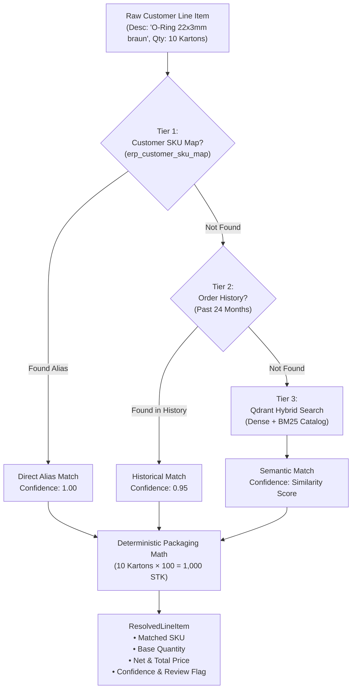

# 3-Tier Cascade SKU Resolution & Packaging Math

> **BetriebsPilot AI Wiki** • Retrieval Augmented Generation (RAG) • Architecture Deep-Dive  
> **Topic**: 3-Tier Resolution Engine, Customer Aliases, Historical Context, Qdrant Hybrid Search & Packaging Unit Math

---

## 1. Executive Summary

In the German B2B wholesale and manufacturing sector (*Mittelstand Großhandel*), customer purchase orders rarely contain the supplier's exact internal part numbers. Instead, orders arrive with:
1. **Customer-Specific Part Numbers**: The customer calls a screw `"MM-0830-VZ"`, while the supplier's ERP stores `"ART-DIN-933-M8X30-88-VZ-1004"`.
2. **Historical References**: *"Schickt uns noch mal die gleichen O-Ringe wie im Auftrag vom März"*.
3. **Vague German Trade Names**: *"50x O-Ring 22mm braun Viton"* or *"10 Kartons Sechskant 8x30"*.
4. **Mismatched Packaging Units**: The customer orders in *"Kartons"* or *"Dosen"*, but the legacy ERP books inventory strictly in base units (*"Stück"* or *"Meter"*).

To resolve these ambiguities with **$\ge 96\%$ accuracy** and **100% GoBD auditability**, BetriebsPilot AI implements a **3-Tier Cascade SKU Resolution Engine**:



---

## 2. The 3 Tiers Explained

### Tier 1: Deterministic Direct Alias Mapping (`erp_customer_sku_map`)

Many German industrial customers maintain their own internal ERP numbering scheme. When they order from our supplier, they write their own SKU.

* **Database Table**: `erp_customer_sku_map`
* **Lookup**:
  ```sql
  SELECT m.matched_internal_sku, a.title_de, a.base_uom, a.packaging_unit, a.packaging_qty, a.unit_price_net
  FROM erp_customer_sku_map m
  JOIN erp_articles a ON a.sku = m.matched_internal_sku
  WHERE m.customer_id = %s 
    AND (m.raw_customer_sku ILIKE %s OR m.raw_customer_sku ILIKE %s);
  ```
* **Speed**: $< 1\text{ms}$ (B-Tree primary key index in PostgreSQL).
* **Confidence**: **1.00** (100% guaranteed match).
* **Self-Learning Loop**: Whenever a human clerk reviews a low-confidence item in the Split-Screen UI and clicks "Approve", the system automatically inserts the customer's alias into `erp_customer_sku_map`. The next time that customer orders that item, it hits **Tier 1 instantly**!

---

### Tier 2: 24-Month Customer Order History (`erp_orders` + `erp_order_items`)

If the customer does not provide a known alias code, they often re-order standard items they regularly buy using informal descriptions (*"Noch 20 Dosen 22mm Dichtringe"*).

* **Database Query**:
  ```sql
  SELECT i.sku, a.title_de, a.base_uom, a.packaging_unit, a.packaging_qty, a.unit_price_net,
         COUNT(*) as frequency
  FROM erp_order_items i
  JOIN erp_orders o ON o.order_id = i.order_id
  JOIN erp_articles a ON a.sku = i.sku
  WHERE o.customer_id = %s
    AND (i.raw_description ILIKE %s OR a.title_de ILIKE %s)
  GROUP BY i.sku, a.title_de, a.base_uom, a.packaging_unit, a.packaging_qty, a.unit_price_net
  ORDER BY frequency DESC
  LIMIT 1;
  ```
* **Speed**: $\approx 2 - 5\text{ms}$.
* **Confidence**: **0.95** (High historical probability).

---

### Tier 3: Qdrant Hybrid Semantic Search (`german_erp_catalog`)

If the customer has never ordered this item before, we perform semantic vector search over the master ERP catalog in Qdrant:

1. **Embedding**: We embed the customer's raw description using FastEmbed (`BAAI/bge-small-en-v1.5` or `sentence-transformers/paraphrase-multilingual-MiniLM-L12-v2`).
2. **Qdrant Search**:
   ```python
   search_results = qdrant_client.search(
       collection_name="german_erp_catalog",
       query_vector=query_vector,
       limit=3
   )
   ```
3. **Speed**: $< 3\text{ms}$ via HNSW graph traversal.
4. **Confidence**: Equal to the cosine similarity score (typically $0.80 - 0.94$).

---

## 3. Deterministic Packaging Unit Math

German legacy ERPs (SAP Business One, Sage 100, proALPHA) store inventory and base prices in **Base Units of Measure** (`STK` = Stück, `MTR` = Meter). However, customers order in **Packaging Units** (*Kartons, Pakete, Dosen, Rollen*).

### The Mathematical Formula:

$$\text{Base Quantity} = \text{Ordered Quantity} \times \text{Packaging Factor}$$

$$\text{Total Net Price} = \text{Base Quantity} \times \text{Unit Price Net}$$

### Unit Normalization Mapping:
Customers write unit abbreviations inconsistently. The resolver normalizes them into standard ISO/DIN ERP codes:

| Customer Input Variants | Normalized ERP Code | Description | Typical Packaging Factor |
|:---|:---:|:---|:---:|
| `stk`, `stück`, `stueck`, `st`, `pcs` | `STK` | Stück (Piece / Base) | $1$ |
| `karton`, `kartons`, `ktn`, `ktns`, `ctn` | `KTN` | Karton (Box) | $50 - 200\text{ STK}$ |
| `paket`, `pakete`, `pak`, `pk` | `PAK` | Paket (Package) | $10 - 50\text{ STK}$ |
| `dose`, `dosen`, `dos` | `DOS` | Dose (Canister/Can) | $12 - 24\text{ STK}$ |
| `rolle`, `rollen`, `rll` | `RLL` | Rolle (Roll) | $50\text{ MTR}$ |
| `set`, `sets`, `satz` | `SET` | Set | $1\text{ SET}$ |

### Concrete Real-World Example:
1. Customer writes: `"10 Kartons Sechskantschrauben M8x30"`
2. Master Article: `ART-DIN-933-M8X30-88-VZ`
   - `base_uom`: `"STK"`
   - `packaging_unit`: `"KTN"`
   - `packaging_qty`: `100` (100 pieces per box)
   - `unit_price_net`: `0.18 €` per piece
3. **Deterministic Math**:
   - $\text{Base Quantity} = 10 \times 100 = 1{,}000\text{ STK}$
   - $\text{Total Net Price} = 1{,}000 \times 0.18 = 180.00\text{ EUR}$
   - $\text{Total Gross Price} (19\% \text{ USt}) = 180.00 \times 1.19 = 214.20\text{ EUR}$

---

## 4. Human-in-the-Loop (HITL) Gate Rules

To comply with GoBD accounting guidelines, an order line is flagged for mandatory clerk review (`requires_human_review = True`) if:
1. **Confidence $< 0.95$**: The item was resolved via Tier 3 semantic search with a borderline similarity score.
2. **Packaging Mismatch**: The customer ordered in an unexpected unit (e.g. *"Palette"* or *"Fass"* when the catalog only defines *"STK"*).
3. **Out-of-Stock**: Available-to-Promise stock is insufficient ($\text{ATP} < \text{Base Quantity}$).

When approved by a clerk, Tier 1 is updated, creating a **perpetual self-improving system**.
