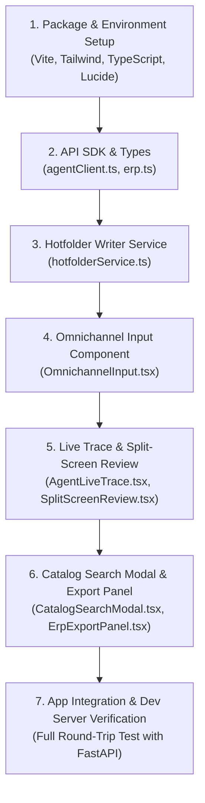

# Desktop Client — Architecture & Implementation Plan

> **Target**: BetriebsPilot AI Desktop Client for Legacy ERP Integration  
> **Tech Stack**: Vite + React 18 + TypeScript + Tailwind CSS + Lucide Icons (Tauri v2 ready)  
> **Target Audience**: German ERP Order Clerks (*Auftragssachbearbeiter im Großhandel*)

---

## 1. Why a Desktop Client for Legacy German ERPs?

German *Mittelstand* suppliers run legacy on-premise ERP systems (**SAP Business One, Sage 100, proALPHA, abas**) installed on local Windows PCs or internal LAN servers.

These legacy systems do not have modern GraphQL/REST webhooks. Instead, they ingest external orders via **file hotfolders**:
* An internal Windows daemon continuously watches a directory on disk:
  ```
  C:\ERP_Import\Incoming_Orders\
  # or on Linux/macOS:
  /tmp/erp_import/
  ```
* As soon as an XML or CSV file (e.g., `ORDER_DE-10021_PO-8812.xml`) is written to that folder, the ERP automatically picks it up, validates it, and generates a sales order.

### The Sandbox Problem: Why Standard Web Browsers Fail
Standard web browsers operate inside an isolated OS sandbox. A web page running in Chrome or Safari **cannot silently write files to arbitrary local disk paths** like `C:\ERP_Import\` without prompting the user with save dialogs every single time.

The **BetriebsPilot Desktop Client** solves this:
1. Runs locally on the clerk's desktop with OS file system privileges.
2. Connects over HTTP / SSE to the remote FastAPI AI Agent.
3. Automatically writes validated OpenTRANS 2.1 XML and SAP B1 JSON directly into the ERP watch-folder upon 1-click clerk approval.

---

## 2. Technology Stack & Library Selection

| Layer | Technology | Justification |
| :--- | :--- | :--- |
| **Bundler & Tooling** | **Vite 6** | Instant Hot Module Replacement (HMR), lightweight, native ESM, and first-class TypeScript support. |
| **UI Framework** | **React 18** | Industry-standard declarative UI with reactive state management, perfect for high-density ERP dashboards. |
| **Type Safety** | **TypeScript 5** | Shared type contracts mirroring backend Pydantic models 1:1, preventing serialization bugs. |
| **Styling** | **Tailwind CSS v3** | Fast enterprise styling, dark/light theme support, high information density without heavy component bloat. |
| **Icons** | **Lucide React** | Clean, modern vector icons for ERP status badges, documents, and action buttons. |
| **Streaming** | **Server-Sent Events (SSE)** | Native `EventSource` connection to FastAPI `/api/v1/stream-trace/{task_id}` for zero-latency live agent node execution. |
| **Native Integration** | **Tauri v2 + Web Fallback** | Native desktop windowing with direct disk access, plus an HTML5 File System API fallback for instant web browser testing. |

---

## 3. High-Density 3-Column UI Layout

The client is designed as a mission-control dashboard for commercial clerks:

```
+----------------------------------------------------------------------------------------------------+
|  BETRIEBSPILOT AI — Legacy ERP Cockpit                                 [ ● Server: Online (8000) ] |
+----------------------------+---------------------------------------+-------------------------------+
| COLUMN 1: INPUT QUEUE      | COLUMN 2: SPLIT-SCREEN REVIEW         | COLUMN 3: ERP EXPORT & AUDIT  |
|                            |                                       |                               |
| [PDF] [Email] [WhatsApp]   | [1. Live LangGraph Trace]             | [Format Selector]             |
|                            |   ● Intent -> RAG -> Stock -> Gate    |   (•) OpenTRANS 2.1 XML       |
| Customer Selector:         |                                       |   ( ) SAP Business One JSON   |
| [DE-10021 - Müller ...]    | [2. Source Document Text]             |                               |
|                            |   "10 Kartons DIN 933 M8x30..."       | Target Watchfolder:           |
| Pre-loaded B2B Templates:  |                                       | [/tmp/erp_import            ] |
| [Müller Standard Order]    | [3. Editable ERP Line Items Table]    |                               |
| [Vague Sealing Inquiry]    |   SKU | Qty | UoM | Price | Stock     | GoBD Order Summary:           |
|                            |   ART-.. 1000  STK  138.00€ [InStock] | Items: 3   | Conf: 96.5%      |
| [Drag & Drop PDF Zone]     |   [🔍 Semantic Catalog Search Modal]  | Net Total:    1,742.60 €      |
|                            |                                       | 19% VAT:        331.09 €      |
| [⚡ Process Order Button]   | [Override Values / Change SKU]        | Gross Total:  2,073.69 €      |
|                            |                                       |                               |
|                            |                                       | [✓ Approve & 1-Click Export]  |
+----------------------------+---------------------------------------+-------------------------------+
```

---

## 4. Component Hierarchy & Architecture

```
desktop-client/src/
├── api/
│   └── agentClient.ts              # Typed API SDK for FastAPI REST & SSE endpoints
├── types/
│   └── erp.ts                      # Shared TypeScript data contracts (1:1 with Pydantic)
├── services/
│   └── hotfolderService.ts         # Abstraction for writing XML/JSON to local hotfolders
├── components/
│   ├── OmnichannelInput.tsx        # Column 1: Multi-channel input & customer selection
│   ├── AgentLiveTrace.tsx          # Column 2 Top: Live LangGraph node execution stepper
│   ├── SplitScreenReview.tsx       # Column 2 Bottom: Source doc vs. editable ERP table
│   ├── CatalogSearchModal.tsx      # Modal: Qdrant semantic vector search for clerk overrides
│   └── ErpExportPanel.tsx          # Column 3: Format toggle, audit summary & 1-click export
├── App.tsx                         # Master layout coordinating state and SSE streams
└── main.tsx                        # Application bootstrap
```

### Component Roles & Responsibilities

1. **`OmnichannelInput.tsx`**:
   - Allows switching between PDF dropzone, raw Email text, or WhatsApp chat simulator.
   - Fetches customer list dynamically from `GET /api/v1/customers`.
   - Offers one-click demo presets so clerks can test without typing.
   - Sends multipart request to `POST /api/v1/process-input`.

2. **`AgentLiveTrace.tsx`**:
   - Subscribes to `GET /api/v1/stream-trace/{task_id}` via `EventSource`.
   - Renders animated state nodes:
     `classify_intent` $\rightarrow$ `ingest_and_resolve` $\rightarrow$ `check_inventory_atp` $\rightarrow$ `confidence_gate`.
   - Provides instant visual feedback of backend agent reasoning.

3. **`SplitScreenReview.tsx`**:
   - Displays the original unstructured German document alongside the structured ERP lines.
   - Highlights Confidence badges:
     - 🟢 **Tier 1 (Direct Alias)**: $\ge 98\%$
     - 🔵 **Tier 2 (Order History)**: $\ge 95\%$
     - 🟡 **Tier 3 (Qdrant Vector)**: $80\% - 94\%$
     - 🔴 **Unresolved / Low Confidence**: $< 80\%$
   - Displays real-time Available-to-Promise (ATP) stock badges:
     - 🟢 **In Stock**: $\text{ATP} \ge \text{Ordered Qty}$
     - 🔴 **Lieferrückstand (Backorder)**: $\text{ATP} < \text{Ordered Qty}$
   - Allows inline editing of quantities, units, and prices.
   - Opens `CatalogSearchModal` to replace any SKU with a Qdrant semantic vector lookup.

4. **`ErpExportPanel.tsx`**:
   - Displays the GoBD financial audit breakdown (Net, 19% VAT, Gross).
   - Allows choosing output standard: **OpenTRANS 2.1 XML** or **SAP Business One JSON**.
   - Triggers `POST /api/v1/approve-and-export`:
     - Updates `erp_customer_sku_map` in PostgreSQL if clerk made SKU corrections (Self-learning loop).
     - Calls `hotfolderService` to silently write the file to the ERP import directory.
   - Features a toggleable raw XML/JSON code viewer.

---

## 5. TypeScript Data Contracts (Mirroring Backend Pydantic)

```typescript
// Shared Types matching agent-backend/src/api/schemas.py
export interface CustomerSummary {
  customer_id: string;
  company_name: string;
  city: string;
  vat_id: string;
  billing_email: string;
}

export interface ResolvedLineItem {
  line_number: number;
  raw_item_number?: string;
  matched_sku: string;
  title_de: string;
  ordered_quantity: number;
  ordered_uom: string;
  packaging_factor: number;
  base_quantity: number;
  base_uom: string;
  unit_price_net: number;
  total_price_net: number;
  tax_rate: number;
  confidence_score: number;
  resolution_tier: 'TIER_1_DIRECT_ALIAS' | 'TIER_2_ORDER_HISTORY' | 'TIER_3_QDRANT_HYBRID' | 'UNRESOLVED';
  requires_review: boolean;
}

export interface InventoryCheckResult {
  sku: string;
  title_de: string;
  required_quantity: number;
  physical_stock: number;
  reserved_stock: number;
  incoming_stock: number;
  atp_stock: number;
  is_in_stock: boolean;
  shortage_quantity: number;
}

export interface ProcessInputResponse {
  task_id: string;
  status: string;
  intent?: string;
  customer_id: string;
  channel: string;
  extracted_document?: any;
  resolved_items: ResolvedLineItem[];
  inventory_checks: InventoryCheckResult[];
  overall_confidence: number;
  total_net_amount: number;
  total_gross_amount: number;
  requires_human_review: boolean;
  review_reasons: string[];
  export_format: string;
  generated_export_payload?: string;
  execution_trace: string[];
}
```

---

## 6. Implementation Sequence



---

## 7. Verification & Acceptance Criteria

1. **API Connectivity**: Desktop Client boots, reaches `http://localhost:8000/health`, and retrieves customer directory.
2. **Preset Execution**: Selecting a demo template (e.g. *Müller Maschinenbau*) and clicking "Process Order" sends input to FastAPI and receives parsed items.
3. **Live SSE Trace**: During processing, LangGraph nodes visually animate through the 4 steps in real time.
4. **Interactive Review**: Clerk can edit row quantities or use the Qdrant Search Modal to override a SKU.
5. **One-Click Hotfolder Export**: Clicking "Approve & Export" writes the XML/JSON file to the local folder (`/tmp/erp_import` or browser download) and triggers self-learning in PostgreSQL.
